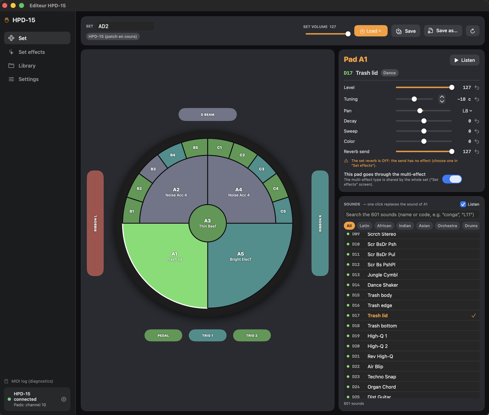

# HPD-15 Editor

A native macOS editor and librarian for the **Roland HandSonic HPD-15**, written in Swift / SwiftUI.

Build your own percussion sets on the Mac, keep them in a library of files, and send them back to the HPD-15 in one click. Strike a pad on the instrument or click it on screen: it gets selected and is ready to receive another sound.

The interface is available in **English and French** (automatic, or chosen in Settings).



> This project replaces the earlier Electron prototype [`hpd15-studio`](https://github.com/Kitusai/hpd15-studio), now archived.

## Features

- **Set screen**: faithful drawing of the HPD-15 surface (pads A1–C5, ribbons, D Beam, pedal, external triggers). Select a zone by clicking it or by playing it. The 601 instruments are listed by family with search; one click assigns a sound to the selected pad and plays it. Per-pad level, tuning, pan (fixed / random / alternate), decay, sweep, color, reverb send and multi-effect routing are sent live to the HPD-15.
- **Factory and user patches**: load any of the 160 presets or 80 user memories as the starting point of a set.
- **Set effects**: reverb (18 types) and multi-effect (85 types, on/off, depth, level, reverb send), with the list of zones routed to the multi-effect. Effects are clearly shown as set-wide settings.
- **Library**: one `.hpdset` file (JSON) per set, holding the complete patch data plus name, description and tags. Search, duplicate, move to Trash, **Save** (⌘S) / **Save as…** (⇧⌘S). *Send to HPD-15* writes the set into the current (temporary) patch, reads it back and checks it.
- **Patch changes made on the instrument** are detected and handled (automatic read, or a question if the set on screen has unsaved changes).
- **Settings**: language, sound family colors, auditioning options.

The editor **never writes to the HPD-15 user memories**: it only uses the temporary patch. Use [WRITE] on the instrument if you want to store a set there.

## Requirements

- macOS 12 or later, Intel or Apple Silicon.
- A MIDI interface connected to the HPD-15 MIDI IN and OUT (developed with a Roland UM-ONE).
  With a UM-ONE, set its physical switch to **TAB** (class-compliant mode on macOS), not COMP.
- HPD-15 Device ID 17 (factory setting). Recommended: SYSTEM > UTILITY > Seq Sync = Int, SYSTEM > MIDI > Soft Thru = OFF.
- To build: Xcode or just the Command Line Tools (`xcode-select --install`).

## Build and run

```sh
git clone https://github.com/Kitusai/hpd15-editor.git
cd hpd15-editor
swift run HPD15            # run directly
./make-app.sh              # or build "Editeur HPD15.app" (universal binary, custom icon)
```

`make-app.sh` builds arm64 and x86_64 separately and merges them with `lipo`, so a full Xcode install is not required. The app is signed ad hoc: on another Mac, open it the first time with right-click > Open. When copying the app between Macs, zip it first (Finder > Compress): cloud drives may strip the executable permission.

Other targets:

```sh
swift run HPD15Checks      # self-tests, no hardware needed
swift run HPD15Diag        # console MIDI diagnostics (see below)
```

## MIDI diagnostics tool

`HPD15Diag` talks to the instrument from the terminal and writes a log in `Journaux/`. Commands: `complet` (default, read-only), `ports`, `ecoute` (shows which notes the pads send), `ecriture` (write test, restored afterwards), `cadence` (measures the required delay between messages), `effets` (guided effects test), `charger P0101`, `user U0101`. Options: `--port "UM-ONE"`, `--dev 10`, `--canal 10`, `-v`. *(The diagnostics tool is in French.)*

## Technical notes

The SysEx implementation was checked on real hardware. Highlights (details in [docs/HPD-15-SysEx.md](docs/HPD-15-SysEx.md)):

- Model ID is `00 2E` (two bytes).
- **The HPD-15 silently ignores any message received less than ~30 ms after one of its own replies.** The client waits 100 ms after every received message. This was the cause of the unreliable communication of the prototype.
- A whole patch is read with one dump request (`11 00 00 00`, 27 DT1 messages in about 2 s).
- Instrument, pitch, pan and note values are "nibbled" (4 bits per byte).
- Reverb and multi-effect type values are *list position + 1*, unlike what the manual suggests.
- Writing a Pad Set instrument applies its five sounds to the whole row, so the editor never sends it.

## Project layout

| Target | Role |
|---|---|
| `HPD15Core` | Roland SysEx frames, address map, nibble encoding, MIDI client, sound catalogue (JSON) |
| `HPD15` | The SwiftUI application |
| `HPD15Diag` | Console diagnostics |
| `HPD15Checks` | Tests without hardware |

## License

MIT, see [LICENSE](LICENSE). Roland, HandSonic and HPD-15 are trademarks of Roland Corporation; this project is not affiliated with Roland. Sound, preset and effect names come from the HPD-15 Owner's Manual.
